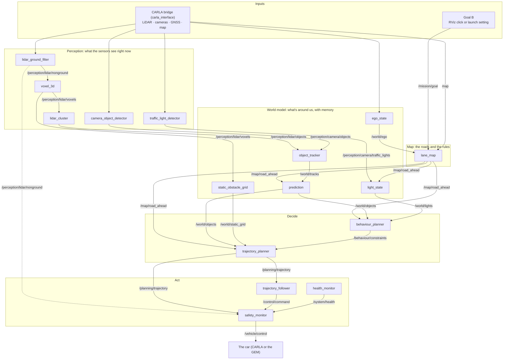

# Navigator source code

This is the code for Navigator's new architecture. This page explains how the pieces fit together, what's built and what isn't, and how every package should be written.

**Looking for something to work on?** Start with the [roadmap issue (#33)](https://github.com/Nova-UTD/navigator_2026/issues/33): it explains the shared ideas, shows what blocks what, and lists every issue. The [Navigator 2026 Roadmap project](https://github.com/orgs/Nova-UTD/projects/9) has them in the order to work on them. Each package's full spec is in its issue, linked in the table below.

## Why a new architecture
The old stack drives well, but every module talked through 2D grids of numbers. A car, a curb and an overhanging branch all looked like "100", nothing remembered anything between frames, and every new behaviour became another grid or another if-branch.

The new stack is built in layers. Each layer has one job and talks to the next through clear messages:

| Layer | Job | Packages |
|---|---|---|
| **Map** | Knows the roads and the rules: lanes, the route from A to B, stop lines, lights, speed limits | `lane_map` |
| **Perception** | What the sensors see in this frame, with no memory | `lidar_ground_filter`, `voxel_3d`, `lidar_cluster`, `camera_object_detector`, `traffic_light_detector` |
| **World model** | What's around us, remembered over time: tracked objects with IDs and speeds, where they're going, things that don't move, our own position, our traffic light | `ego_state`, `static_obstacle_grid`, `object_tracker`, `prediction`, `light_state` |
| **Decide** | Turns the rules into limits, then picks the best safe trajectory | `behaviour_planner`, `trajectory_planner` |
| **Act** | Drives the trajectory, and brakes if anything goes wrong | `trajectory_follower`, `safety_monitor`, `health_monitor` |

**First goal:** drive from A to B on real lanes: follow cars, stop for pedestrians, pass parked cars when it's allowed, and obey lights and stop signs. On any map: a CARLA town, the campus, or anywhere else, with the same code.

## How the pieces connect
Arrows are ROS topics. Every node from the world model down also reads `/world/ego` (left out of the picture to keep it readable).



### What happens every 100 ms
1. The LiDAR ground filter removes the road, and `voxel_3d` builds a 3D voxel volume from what's left (used to project between the cameras, 3D and the grid). The static grid updates, and `lidar_cluster` puts boxes around groups of points.
2. The tracker matches boxes to the objects it already knows, works out their speeds, and adds labels from the camera. Prediction adds where each one is going over the next 5 s.
3. `lane_map` publishes our lane and the rules ahead.
4. `light_state` works out which light is ours and its colour.
5. `behaviour_planner` applies the rules and publishes the limits: walls, speed limit, sideways range.
6. `trajectory_planner` tries about 135 trajectories, throws out the unsafe ones, and publishes the best.
7. `trajectory_follower` (50 times a second) steers and sets the speed to follow it.
8. `safety_monitor` checks the LiDAR along the trajectory and the health of every node, and can brake before the command reaches the car.

## What's in this folder

| Folder | Package | State | Issue |
|---|---|---|---|
| `common/` | `nova_common` | Not started. Shared code: route maths (`frenet.py`), the heartbeat helper | [#17](https://github.com/Nova-UTD/navigator_2026/issues/17), [#15](https://github.com/Nova-UTD/navigator_2026/issues/15) |
| `map/` | `lane_map` | Not started | [#10](https://github.com/Nova-UTD/navigator_2026/issues/10) (sub-issues [#11](https://github.com/Nova-UTD/navigator_2026/issues/11), [#16](https://github.com/Nova-UTD/navigator_2026/issues/16), [#17](https://github.com/Nova-UTD/navigator_2026/issues/17), [#18](https://github.com/Nova-UTD/navigator_2026/issues/18), [#19](https://github.com/Nova-UTD/navigator_2026/issues/19)) |
| `perception/` | `lidar_ground_filter` | **Works** | |
| | `voxel_3d` | Not started | [#12](https://github.com/Nova-UTD/navigator_2026/issues/12) |
| | `lidar_cluster` | Not started | [#20](https://github.com/Nova-UTD/navigator_2026/issues/20) |
| | `camera_object_detector` | **Works**, needs fixing | [#13](https://github.com/Nova-UTD/navigator_2026/issues/13) |
| | `traffic_light_detector` | **Works**, needs checking | [#14](https://github.com/Nova-UTD/navigator_2026/issues/14) |
| `world_model/` | `ego_state` | Not started | [#9](https://github.com/Nova-UTD/navigator_2026/issues/9) |
| | `static_obstacle_grid` | **Works** (still the old 2D grid), needs rework | [#21](https://github.com/Nova-UTD/navigator_2026/issues/21) |
| | `object_tracker` | **Works**, needs rework | [#22](https://github.com/Nova-UTD/navigator_2026/issues/22), [#23](https://github.com/Nova-UTD/navigator_2026/issues/23) |
| | `prediction` | Not started | [#24](https://github.com/Nova-UTD/navigator_2026/issues/24) |
| | `light_state` | Not started | [#25](https://github.com/Nova-UTD/navigator_2026/issues/25) |
| `behaviour/` | `behaviour_planner` | Not started | [#26](https://github.com/Nova-UTD/navigator_2026/issues/26), [#27](https://github.com/Nova-UTD/navigator_2026/issues/27), [#28](https://github.com/Nova-UTD/navigator_2026/issues/28) |
| `planning/` | `trajectory_planner` | Not started | [#29](https://github.com/Nova-UTD/navigator_2026/issues/29) |
| `control/` | `trajectory_follower` | Not started | [#30](https://github.com/Nova-UTD/navigator_2026/issues/30) |
| `safety/` | `guardian` | **Works.** Becomes `health_monitor` | [#15](https://github.com/Nova-UTD/navigator_2026/issues/15) |
| | `safety_monitor` | Not started | [#31](https://github.com/Nova-UTD/navigator_2026/issues/31) |
| `msg/` | message packages | New messages are added by the issue that publishes them | |
| `tools/` | tools and bundled libraries | Unchanged | |

Also: tests and CI [#7](https://github.com/Nova-UTD/navigator_2026/issues/7), the CARLA ground-truth helper [#8](https://github.com/Nova-UTD/navigator_2026/issues/8), the launch file [#32](https://github.com/Nova-UTD/navigator_2026/issues/32), and the campus map [#34](https://github.com/Nova-UTD/navigator_2026/issues/34).

**"Works"** packages came over from the old stack whole and build as before, under their new names and topics. Their messages and logic still change as each one is reworked.

**"Not started"** packages contain only a short `README.md` that points to the package's GitHub issue. **The issue is the full spec**: what the package does and why, the topics and messages, how it works step by step, starting settings, how to test it, when it's done, and **exactly which old code to reuse** (file and line numbers). Read it before writing anything. When you build the package, replace the short README with the real one.

Everything else from the old stack was deleted. It's still in this repo's first commit (`86a6bde`) and in `Nova-UTD/navigator`.

## Running it
Same as before. Start CARLA and the `carla_interface` bridge, then in the Navigator container:

```bash
colcon build --symlink-install
source install/setup.bash
ros2 launch launches/launch.carla.py
```

For now this starts only `lidar_ground_filter` and RViz, so the car doesn't move. New nodes are added to `launches/launch.carla.py` as they're written.

## Topics
| Topic | Published by | Read by |
|---|---|---|
| `/mission/goal` | RViz click or launch setting | `lane_map` |
| `/map/road_ahead` | `lane_map` | `prediction`, `light_state`, `behaviour_planner`, `trajectory_planner` |
| `/perception/lidar/nonground` | `lidar_ground_filter` | `voxel_3d`, `safety_monitor` |
| `/perception/lidar/voxels` | `voxel_3d` | `lidar_cluster`, `static_obstacle_grid` |
| `/perception/lidar/objects` | `lidar_cluster` | `object_tracker` |
| `/perception/camera/objects` | `camera_object_detector` | `object_tracker` |
| `/perception/camera/traffic_lights` | `traffic_light_detector` | `light_state` |
| `/world/ego` | `ego_state` | everything downstream |
| `/world/static_grid` | `static_obstacle_grid` | `trajectory_planner` |
| `/world/tracks` | `object_tracker` | `prediction` |
| `/world/objects` | `prediction` | `behaviour_planner`, `trajectory_planner` |
| `/world/lights` | `light_state` | `behaviour_planner` |
| `/behaviour/constraints` | `behaviour_planner` | `trajectory_planner` |
| `/planning/trajectory` | `trajectory_planner` | `trajectory_follower`, `safety_monitor` |
| `/control/command` | `trajectory_follower` | `safety_monitor` |
| `/vehicle/control` | `safety_monitor` | the car |
| `/system/health` | `health_monitor` | `safety_monitor` |
| `/system/heartbeat` | every node, once a second | `health_monitor` |
| `/safety/status` | `safety_monitor` | RViz, logs, scenario metrics |

Topic names follow `/<layer>/<thing>`.

---

## How to write a package

Every package, Python or C++, is laid out the same way. Each part has one job, so you always know where code goes, and the logic can be tested without ROS, CARLA or a GPU.

### The main idea: keep the logic away from ROS
Split every package into two parts:

- **`core/`: the logic.** Plain Python (or C++) that takes inputs and returns outputs. **No ROS imports**: no `rclpy`, no `rclcpp`, no `*_msgs`.
- **`ros/`: the ROS wrapper.** Reads parameters, subscribes, publishes. **No decisions.** It converts ROS messages into plain data, calls `core`, converts the result back, and publishes it.

Why bother:
- **Fast tests.** You can test `core/` with `pytest` in milliseconds, with no ROS, simulator or GPU.
- **Reuse.** Replay tools, test scripts and other packages can call `core/` directly.
- **Easy to read.** Anyone can open `ros/node.py` and understand the whole node in a minute, because it's only plumbing.
- **Easy to swap.** If ROS messages change, only `ros/convert.py` changes.

### Python layout
```text
behaviour_planner/
  package.xml · setup.py · setup.cfg · resource/behaviour_planner
  behaviour_planner/
    core/                      the logic. No ROS imports
      types.py                 plain dataclasses for this package's data
      config.py                a frozen Config dataclass, filled from params.yaml
      rules.py                 e.g. red light -> wall, speed zone -> limit
      stop_sign.py             e.g. the stop-sign state machine
      planner.py               ONE entry point: step(state, inputs, now, config) -> (state, outputs)
    ros/                       the ROS wrapper. No decisions
      node.py                  parameters, subscribers, publishers, one timer, heartbeat
      convert.py               ROS message <-> core dataclass
      viz.py                   RViz markers showing what this node is doing
  config/params.yaml           every number, with its unit and a comment
  launch/behaviour_planner.launch.py   runs this node on its own
  test/
    test_rules.py · test_stop_sign.py  unit tests on core/ (pytest)
    test_convert.py            messages convert both ways without losing anything
    fixtures/                  small example inputs for the tests
  README.md                    what it does, inputs, outputs, settings, how to run and test
```

### C++ layout
Same split:
```text
lane_map/
  CMakeLists.txt · package.xml
  include/lane_map/core/*.hpp   the logic. No rclcpp
  src/core/*.cpp
  src/node.cpp                  the ROS wrapper
  config/params.yaml
  launch/lane_map.launch.py
  test/test_*.cpp               gtest on core
  README.md
```

### What a node looks like
```python
# behaviour_planner/ros/node.py
class BehaviourPlannerNode(Node):
    def __init__(self):
        super().__init__('behaviour_planner')
        self.cfg = Config.from_params(self)        # read parameters once
        self.state = core.initial_state(self.cfg)
        self.latest = {}                            # topic -> newest message

        # Callbacks only store the newest message. Nothing else.
        self.create_subscription(RouteContext, '/map/road_ahead',
                                 lambda m: self.latest.__setitem__('road', m), 1)
        # ... the other subscriptions, same pattern ...

        self.pub = self.create_publisher(BehaviourConstraints, '/behaviour/constraints', 1)
        self.viz_pub = self.create_publisher(MarkerArray, '/behaviour/constraints/viz', 1)
        self.heartbeat_pub = self.create_publisher(DiagnosticStatus, '/system/heartbeat', 1)
        self.create_timer(1.0 / self.cfg.rate_hz, self.tick)
        self.create_timer(1.0, self.heartbeat)

    def tick(self):
        if not convert.inputs_ready(self.latest):
            return
        now = self.get_clock().now().nanoseconds * 1e-9
        inputs = convert.to_inputs(self.latest)                   # messages -> plain data
        self.state, out = core.step(self.state, inputs, now, self.cfg)  # all the logic
        self.pub.publish(convert.to_msg(out, self.get_clock().now()))   # plain data -> message
        self.viz_pub.publish(viz.markers(out))
```
`core.step` is a pure function: the same inputs always give the same outputs. Tests call it directly.

### The rules
| Rule | Why |
|---|---|
| `core/` never imports ROS | It can be tested in milliseconds and reused anywhere |
| `ros/node.py` makes no decisions | Callbacks only store the newest message. One timer converts, calls `core.step()`, converts back and publishes |
| Time is passed in | `core` gets `now` as an argument and never reads the clock (`time.time()`, `get_clock()`), so the simulator, replays and tests all behave the same |
| Every number lives in `config/params.yaml` | Read once into a `Config` dataclass and passed to `core`. No magic numbers in the code, and every value has its unit and a comment |
| Shared things live in `nova_common` | Lanes, objects, trajectories, route maths and shared message conversions are written once and imported, never copied |
| Every node publishes a heartbeat and RViz markers | `health_monitor` can tell it's alive, and you can see what it's doing |
| Every bug fix comes with a test | A unit test, or a CARLA scenario for a driving bug, so it can't come back |
| Every package has a README | What it does · what it listens to · what it publishes · settings · how to run it alone · how to test it |

### Before you open a PR
- `core/` has no ROS imports. Check with `grep -rE "rclpy|rclcpp|_msgs" <package>/<package>/core` (it should print nothing).
- Unit tests pass: `colcon test --packages-select <package>`.
- New numbers are in `params.yaml` with a unit and a comment.
- The README is up to date.
